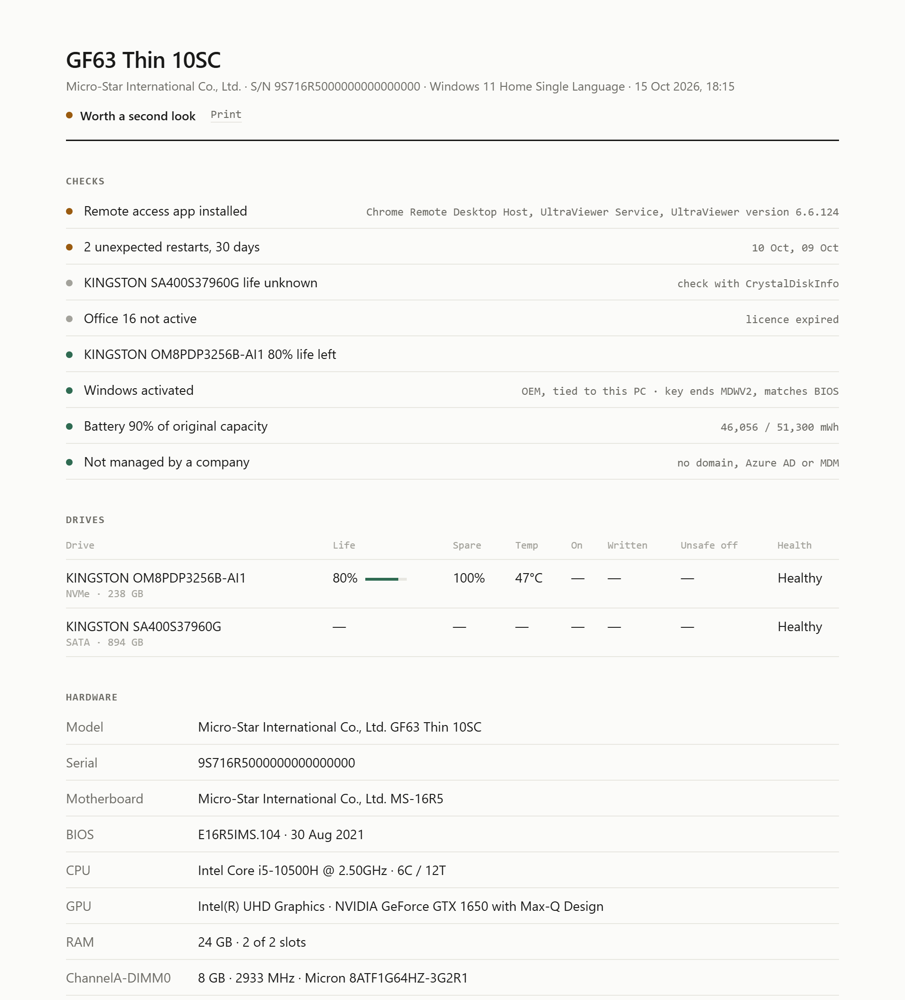

<p align="center">
  
</p>

<p align="center">
  <b>One command. One report. Before you hand over the money.</b><br>
  SecondLook checks a used Windows PC for the problems sellers don't mention,<br>
  and gives you a clean report you can read in a minute.
</p>

<p align="center">
  <a href="#run-it">Run it</a> ·
  <a href="#what-it-checks">What it checks</a> ·
  <a href="#reading-the-report">Reading the report</a> ·
  <a href="#is-it-safe">Is it safe?</a> ·
  <a href="#faq">FAQ</a>
</p>

<br>

## Run it

On the PC you're checking, open **PowerShell** (Start → type `powershell` → Enter) and paste:

```powershell
irm https://raw.githubusercontent.com/honow48-tech/SecondLook/main/check.ps1 | iex
```

1. Click **Yes** when Windows asks for Administrator.
2. Wait about 30 seconds.
3. Press **Enter** to save the report to Downloads, or type another folder.

The report opens in the browser. Nothing is installed and nothing is uploaded.

<br>

## What you get

<picture>
  <source media="(prefers-color-scheme: dark)" srcset="docs/preview-dark.png">
  
</picture>

<sub>Sample report from a real laptop, with the serial number hidden.</sub>

<br><br>

## What it checks

**Things a seller won't tell you**

| Check | Why it matters |
|---|---|
| Managed by a company | Domain, Azure AD or Intune means the owner can lock or wipe it remotely. |
| Remote access apps | AnyDesk, TeamViewer, UltraViewer and others. The seller could still get in. |
| Unexpected restarts | Crashes and power losses in the last 30 days, with dates. |
| Hardware errors | WHEA errors from the CPU, RAM or motherboard. |
| Disk errors | Bad blocks and controller resets logged by Windows. |
| Recently reinstalled | A fresh Windows hides all of the above, so you're told. |
| BitLocker | If it's on, you need the recovery key before you pay. |

**Health**

| Check | Details |
|---|---|
| SSD life | Read from the drive's own health log, the same number as *Settings → Disks*. Also spare, temperature, hours, TB written, unsafe shutdowns. |
| Battery | Capacity left compared with new, and charge cycles. |
| Devices | Anything with a driver problem in Device Manager. |
| RAM | Running below rated speed (XMP / EXPO off), single stick, mixed sticks. |
| GPU | Real VRAM from the driver, to catch fake re-flashed cards. |

**Specs and license**

CPU, GPU, each RAM stick and free slots, screen size and resolution, Wi-Fi, Bluetooth, Ethernet, BIOS, serial number.
Every product key on the PC, whether it's activated, and whether it's **OEM** (stays with the PC), **Retail**, or a **KMS** key (often an unofficial activator). TPM, Secure Boot, antivirus, last update, user accounts.

**Tests inside the report**

- **Screen:** full-screen colours to spot dead pixels and backlight bleed
- **Keyboard:** every key lights up when pressed
- **Speakers:** left, then right
- **Camera & mic:** live preview and a mic level

**Check by hand**

A tick list for what software can't see, picked for laptop or desktop:

- **Laptop:** serial sticker, hinges, swollen battery, every port, the charger, a 10-minute stress test.
- **Desktop:** inside the case (dust, bulging capacitors), PSU brand and wattage, GPU mining wear, fans, front and rear ports, CPU + GPU stress test, CMOS battery.

Custom-built desktops with no model name are named after their motherboard.

<br>

## Reading the report

The top line gives the verdict: **Looks healthy**, **Worth a second look**, or **Needs a closer look**.

Each check is one line, worst first:

| Dot | Means |
|---|---|
| 🔴 Fix | A deal-breaker until it's sorted: company-managed, failing drive, hardware errors. |
| 🟠 Review | Ask the seller about it: remote access apps, repeated crashes, worn battery. |
| ⚪ Note | Good to know: expired Office, extra user accounts. |
| 🟢 OK | Checked and fine. |

Press **Print** in the report to save it as a PDF and keep it with your receipt.

<br>

## Is it safe?

- **It only reads.** It doesn't change settings, install anything or send data anywhere. The only file it writes is the report.
- **One file, open source.** Everything is in [`check.ps1`](check.ps1). Read it before you run it.
- **Product keys stay hidden.** The report shows only the last 5 characters.

Rather not paste a command from the internet? Download [`check.ps1`](check.ps1), right-click it and choose **Run with PowerShell**.

<br>

## FAQ

**Why does it need Administrator?**
Windows only lets Admin read drive health, TPM, Secure Boot and BitLocker. If you say no, it still runs and marks what's missing.

**A drive says "life unknown".**
Some SATA drives store their wear level in a vendor-specific way. Check them with [CrystalDiskInfo](https://crystalmark.info/en/software/crystaldiskinfo/). Please [open an issue](https://github.com/honow48-tech/SecondLook/issues) with the drive model so it can be added.

**Windows 10?**
Yes. Windows 10 and 11, using the PowerShell that comes with Windows. Nothing else is needed.

**Mac or Linux?**
No. Windows only.

**The seller won't let me run it.**
That tells you something too.

<br>

## Contributing

Bug reports and drive models that show "life unknown" are the most useful. Pull requests are welcome. Please keep it one file with no dependencies.

## License

[MIT](LICENSE) © honow48-tech
